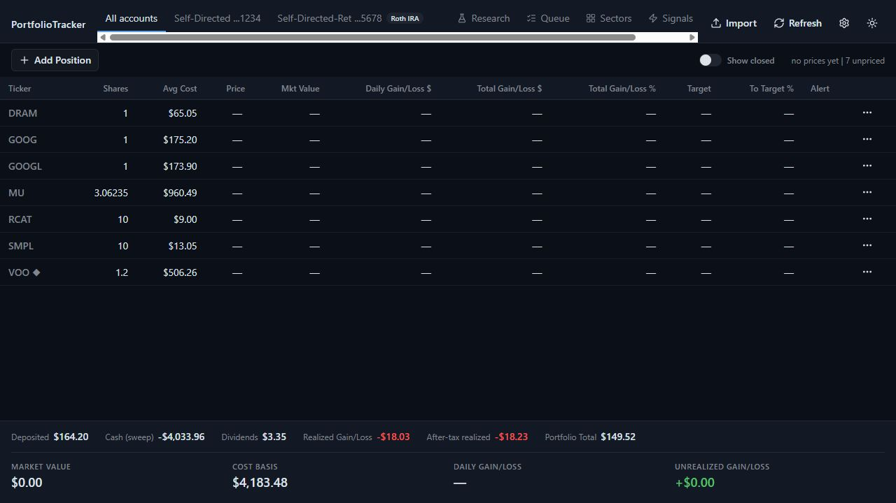

# Portfolio Tracker

[](https://github.com/twbdavis/portfolio-tracker/actions/workflows/ci.yml) [](LICENSE)

**A local Windows workspace for understanding your stock and ETF portfolio.**

[Releases](https://github.com/twbdavis/portfolio-tracker/releases) · [User guide](docs/user-guide.md) · [Report a bug](https://github.com/twbdavis/portfolio-tracker/issues/new/choose)



Import Chase transactions, follow positions and FIFO lots, set price alerts,
and explore portfolio research from one desktop app. Your portfolio database
stays on your computer; no account or cloud backend is required.

- Multi-account tracking with import reconciliation and duplicate detection.
- Cost basis, realized gains, opening balances, and a sell simulator.
- Watchlists, research, sector views, and configurable price alerts.
- Optional market-data and research integrations; keys are configured locally.

## Get started

Windows 10 version 1809 or later, or Windows 11, with the
[Microsoft WebView2 Evergreen Runtime](https://developer.microsoft.com/en-us/microsoft-edge/webview2/)
is required. Release packages target Windows x64.

When a packaged version is available, download its Windows ZIP from
[Releases](https://github.com/twbdavis/portfolio-tracker/releases), extract the
entire folder, and run **PortfolioTracker.Shell.exe**. Self-contained packages
include .NET; WebView2 is a separate prerequisite. If no release is listed yet,
use the source setup below.

### Try fictional data first

1. Start with an empty portfolio and choose **Import Chase CSV**.
2. Select [chase-transactions-sample.csv](samples/chase-transactions-sample.csv).
3. Review the two sample accounts, then complete the import.
4. Check the account tabs: the taxable sample includes 10 RCAT shares; the Roth
   sample includes 0.2 VOO shares. Reimporting the file should not duplicate trades.

No API key is needed to import transactions or inspect lots. Live quotes and
provider-backed research require their corresponding configuration.

## Build from source

Install **Node.js 24**, the **.NET 10 SDK**, the **.NET 8 ASP.NET Core and Desktop
runtimes** for development, and WebView2. The application still targets .NET 8.

```powershell
git clone https://github.com/twbdavis/portfolio-tracker.git
cd portfolio-tracker
./scripts/setup.ps1
```

The script installs frontend dependencies, builds and copies the UI, then launches
the app. Use `-NoLaunch` to stop after building. See
[Development](docs/development.md) for hot reload, tests, and release packaging.

## Data, privacy, and limitations

Data is stored at `%APPDATA%\PortfolioTracker`. Market-data providers receive
requested symbols; optional research providers receive the configured research
requests. AI briefs stay disabled until configured. API keys are stored in a local
settings file, not a credential vault. See [Data and backups](docs/data-and-backups.md).

This is a personal project, with estimates and provider-dependent data. Review
imports against your brokerage records. Tax calculations are estimates, and
unsupported instruments or incomplete history can affect results. Alerts require
the app to remain running. Read the [full limitations](docs/user-guide.md#known-limitations).

## Development and contribution

C# / .NET · WinForms + WebView2 · React + TypeScript · SQLite · xUnit + Vitest

[Architecture](docs/architecture.md) · [Contributing](CONTRIBUTING.md) · [Security](SECURITY.md)

## License

[MIT](LICENSE) © 2026 Thomas Davis.
